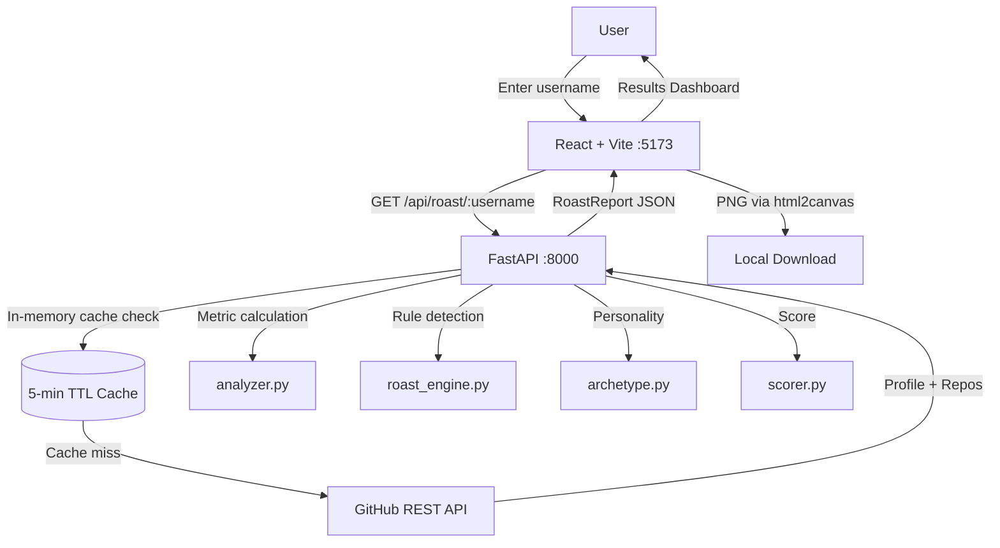

# 🔥 Roast My GitHub

> *Your GitHub looks fine. Your commit history has other opinions.*

A full-stack web application that analyzes your public GitHub profile and delivers a personalized, humorous, data-driven **developer roast**. No AI API keys required — everything runs locally with a deterministic rule-based engine.

---

## ✨ Features

- **🔥 Personalized Roasts** — Rule-based engine analyzing real GitHub data: repo names, activity, languages, stars, forks, and more
- **🎭 Developer Archetypes** — 9 personality classifications from "The Tutorial Collector" to "The Quietly Competent Developer"
- **📊 GitHub Chaos Score** — A humorous 0-100 metric with breakdown of contributing factors
- **📈 Visual Dashboard** — Language distribution charts, repository stats, activity metrics
- **🏆 Most Roastable Repo** — Algorithmically selected worst offender
- **✨ Positive Findings** — Always highlights genuine strengths
- **📸 PNG Export** — Download a shareable roast card
- **📋 Clipboard Copy** — Copy a plain-text roast summary
- **⚡ Response Caching** — 5-minute in-memory cache to respect GitHub rate limits
- **🌓 Dark Theme** — Stunning dark developer-themed UI with animations

---

## 📸 Screenshots

*After running the app, add screenshots here:*

```
screenshots/
  landing.png          # Landing page with input
  loading.png          # Analysis loading screen
  results-top.png      # Profile card + Chaos Score
  results-roasts.png   # Roast categories
  roast-card.png       # Exported PNG card
```

---

## 🛠️ Technology Stack

| Layer | Technology |
|-------|-----------|
| Frontend | React 18, Vite, Tailwind CSS |
| Charts | Recharts |
| Icons | Lucide React |
| Export | html2canvas |
| Backend | Python 3.11+, FastAPI |
| HTTP Client | HTTPX (async) |
| Validation | Pydantic v2 |
| Tests (BE) | Pytest, pytest-asyncio |
| Tests (FE) | Vitest, Testing Library |
| Data Source | GitHub REST API (public endpoints) |

---

## 🏗️ Architecture



---

## 📁 Project Structure

```
roast-my-github/
├── frontend/
│   ├── src/
│   │   ├── api/            # API client
│   │   ├── components/     # Reusable UI components
│   │   ├── pages/          # Page-level views
│   │   └── test/           # Frontend tests
│   ├── package.json
│   ├── vite.config.js
│   └── tailwind.config.js
│
├── backend/
│   ├── app/
│   │   ├── main.py         # FastAPI entry + cache + endpoints
│   │   ├── config.py       # Settings (env vars)
│   │   ├── github_client.py # GitHub REST API client
│   │   ├── analyzer.py     # Metric extraction
│   │   ├── roast_engine.py # Rule-based roast detectors
│   │   ├── archetype.py    # Developer archetype classifier
│   │   ├── scorer.py       # Chaos score calculator
│   │   └── models.py       # Pydantic models
│   ├── tests/              # Pytest test suite (20 tests)
│   ├── requirements.txt
│   └── pytest.ini
│
├── .env.example
├── .gitignore
└── README.md
```

---

## 🚀 Installation & Setup

### Prerequisites

- Python 3.11 or later
- Node.js 18 or later
- npm 9 or later

---

### Windows

```powershell
# 1. Clone the repository
git clone https://github.com/yourusername/roast-my-github.git
cd roast-my-github

# 2. Backend setup
cd backend
python -m venv venv
.\venv\Scripts\Activate.ps1
pip install -r requirements.txt

# 3. (Optional) Configure environment
copy .env.example .env
# Edit .env and add your GitHub token (see below)

# 4. Start the backend
uvicorn app.main:app --reload --port 8000

# 5. In a new terminal: Frontend setup
cd ..\frontend
npm install
npm run dev
```

### macOS / Linux

```bash
# 1. Clone the repository
git clone https://github.com/yourusername/roast-my-github.git
cd roast-my-github

# 2. Backend setup
cd backend
python3 -m venv venv
source venv/bin/activate
pip install -r requirements.txt

# 3. (Optional) Configure environment
cp .env.example .env
# Edit .env and add your GitHub token

# 4. Start the backend
uvicorn app.main:app --reload --port 8000

# 5. In a new terminal: Frontend setup
cd ../frontend
npm install
npm run dev
```

Open [http://localhost:5173](http://localhost:5173) in your browser.

---

## 🔧 Environment Variables

| Variable | Default | Description |
|----------|---------|-------------|
| `GITHUB_TOKEN` | *(none)* | Optional GitHub personal access token (increases rate limit from 60 to 5000 req/hr) |
| `CACHE_TTL_SECONDS` | `300` | How long to cache roast results per username |
| `MAX_REPOS_TO_ANALYZE` | `100` | Maximum number of repositories to analyze |
| `PORT` | `8000` | Backend server port |
| `VITE_API_URL` | *(empty)* | Frontend API URL override (uses Vite proxy by default) |

### Creating a GitHub Token (Optional but Recommended)

1. Go to [GitHub Settings → Developer settings → Personal access tokens](https://github.com/settings/tokens)
2. Generate a new token (classic) with **no scopes** (public data only)
3. Add it to your `.env` file: `GITHUB_TOKEN=ghp_your_token_here`

---

## 📡 API Endpoints

### `GET /api/health`
Health check.

**Response:**
```json
{"status": "ok", "version": "1.0.0"}
```

---

### `GET /api/roast/{username}`
Analyze a GitHub username and return a full roast report.

**Parameters:**
- `username` — GitHub username (1-39 alphanumeric chars or hyphens)

**Success Response (200):**
```json
{
  "profile": {
    "username": "octocat",
    "name": "The Octocat",
    "avatar_url": "https://...",
    "html_url": "https://github.com/octocat",
    "public_repos": 8,
    "followers": 15000,
    "following": 9
  },
  "activity_metrics": {
    "total_repos": 8,
    "original_repos": 6,
    "forked_repos": 2,
    "avg_stars": 35.0,
    "total_stars": 280,
    "inactive_repos_count": 3,
    "recent_activity_repos": 2
  },
  "language_stats": [
    {"language": "Ruby", "count": 4, "percentage": 66.7},
    {"language": "JavaScript", "count": 2, "percentage": 33.3}
  ],
  "chaos_score": {
    "total": 38,
    "breakdown": [...],
    "interpretation": "Mild chaos. A few skeletons in the closet.",
    "disclaimer": "This score is a joke metric..."
  },
  "archetype": {
    "title": "The Quietly Competent Developer",
    "description": "...",
    "confidence": "high"
  },
  "roast_categories": [...],
  "positive_findings": [...],
  "most_roastable_repo": {...},
  "warnings": []
}
```

**Error Responses:**
- `404` — GitHub user not found
- `422` — Invalid username format
- `429` — GitHub API rate limit exceeded (add a token to resolve)
- `500` — Server error

---

## 🧪 Testing

### Backend Tests (20 tests)

```bash
cd backend
python -m pytest tests/ -v
```

Test coverage:
- `test_analyzer.py` — Metric calculation (5 tests)
- `test_api.py` — FastAPI endpoints (5 tests)
- `test_roast_engine.py` — All 6 roast detectors + determinism (6 tests)
- `test_scorer.py` — Chaos score calculation (4 tests)

### Frontend Tests

```bash
cd frontend
npm test
```

Test coverage:
- `LandingPage.test.jsx` — Input validation, rendering
- `App.test.jsx` — State transitions, error handling, reset flow

---

## ⚡ GitHub API Limitations

| Limitation | Handling |
|-----------|----------|
| 60 req/hr without token | Graceful 429 error with message to add token |
| 5000 req/hr with token | Supported via `GITHUB_TOKEN` env var |
| No private repo data | Only public repositories analyzed |
| No contribution calendar | Inactivity detected from `updated_at` timestamps |
| No detailed commit history | Activity metrics based on repo-level timestamps |

The app never invents data. If metrics can't be calculated, results are labeled "Unavailable" or omitted.

---

## 🎯 Roast Categories

| Category | What it detects |
|---------|----------------|
| 🗂️ Repository Chaos | Chaotic names (`final`, `v2`, `copy`), high fork ratio, low engagement |
| 🏛️ Abandoned Museum | Inactive repos (>365 days), high abandonment rate |
| 📖 README Dreamer | Missing descriptions, undocumented projects |
| 🌐 Language Identity | Language hopping (>5 languages), single-language commitment |
| ⭐ Popularity Department | Zero stars, low engagement on many repos |
| 📊 Commit Patterns | No recent activity, ancient account with low output |

---

## 🧬 Chaos Score Formula

```
Score = Σ (factor_score / factor_max) × factor_weight

Factors:
  Repo Naming Chaos    → 0-20 pts
  Abandonment Rate     → 0-25 pts  
  Missing Docs         → 0-20 pts
  Fork Ratio           → 0-15 pts
  Low Engagement       → 0-20 pts
  ─────────────────────────────────
  Total                → 0-100 pts
```

Scores are deterministic — the same profile will always produce the same score.

---

## 📦 Example Output

Using sample data for `octocat`:

```
🔥 GitHub Roast Report for @octocat

Archetype: The Quietly Competent Developer
Chaos Score: 22/100 — Mild chaos. A few skeletons in the closet.

Top Roasts:
1. [Abandoned Museum] Repo 'Spoon-Knife' hasn't been touched in 1,378 days. It
   technically still exists, which is more than can be said for most of your ideas.
2. [README Dreamer] 3 repositories are content with absolutely no description.
   Mystery is for novels, not software projects.
3. [Popularity Department] 280 total stars with 'Hello-World' holding the crown.
   One hit wonder energy detected.

Get roasted at: roast-my-github.dev
```

---

## 🔮 Future Improvements

- [ ] GitHub OAuth login for higher rate limits
- [ ] Animated SVG commit timeline visualization
- [ ] "Roast a Friend" — compare two profiles
- [ ] Shareable link with slug (`/r/octocat`)
- [ ] Weekly roast leaderboard
- [ ] More roast templates and archetype categories
- [ ] Browser extension

---

## 📄 License

MIT License. See [LICENSE](LICENSE) for details.

---

*Built with 🔥 and questionable judgment. No developers were harmed in the making of this application (probably).*
